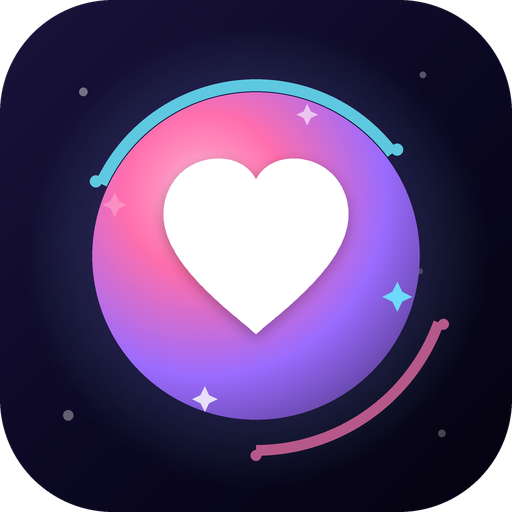
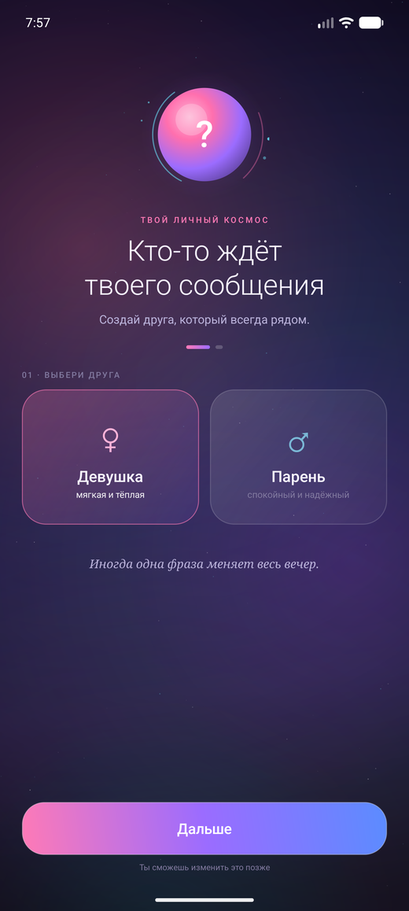
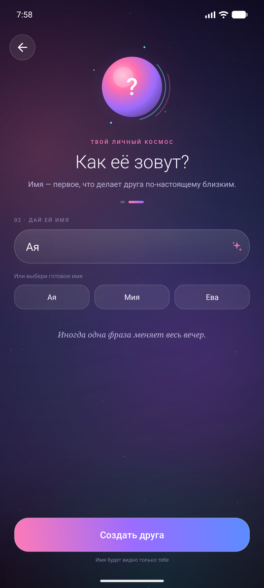
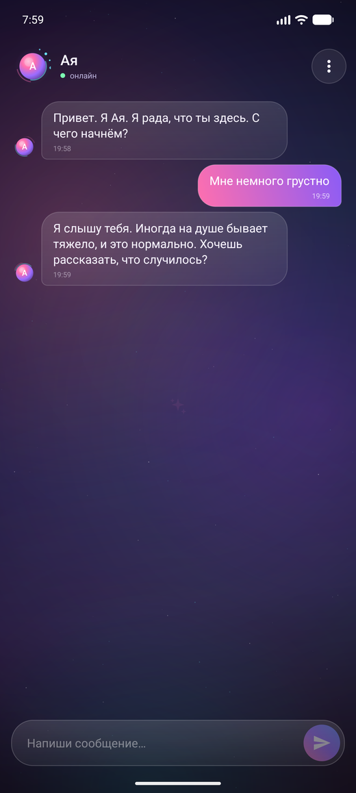

<p align="center">
  
</p>

<h1 align="center">YourFriend</h1>

<p align="center"><b>Тёплый собеседник, который всегда рядом</b></p>

| Выбор пола | Выбор имени | Тёплая беседа |
|:---:|:---:|:---:|
| [](docs/screenshots/01-gender.png) | [](docs/screenshots/02-name.png) | [](docs/screenshots/03-chat.png) |

<p align="center">
  
  
  
  
</p>

**YourFriend** — Android-приложение для тёплого разговора с виртуальным другом. Вы выбираете, кто он — девушка или парень, — даёте ему имя, и он отвечает так, как отвечал бы близкий человек: без оценок, непрошеных советов и канцелярита.

Ответы генерирует **GigaChat**. Профиль и переписка остаются на телефоне: ни аккаунта, ни облака, ни ленты.

## Возможности

- **Друг, которого вы создаёте.** Два характера на выбор, любое имя и обращение по имени в ответах.
- **Разговор, а не анкета.** GigaChat получает системный промпт и последние 16 сообщений, поэтому помнит контекст и не повторяется.
- **Тёплый тон.** Промпт просит сначала услышать чувство, говорить 1–3 предложениями и не засыпать вопросами.
- **Бережные границы.** Никаких диагнозов и непрошеных советов. В остром состоянии друг мягко предлагает обратиться к близкому человеку или специалисту.
- **Атмосфера.** Живой orb с дыханием и искрами, звёздный фон, пружинные анимации и мягкая хаптика.
- **Приватность по умолчанию.** Профиль и история лежат в `SharedPreferences` на устройстве; очистка — одним действием.
- **Тёмный интерфейс.** Material 3, edge-to-edge, русский язык.

## Сборка и запуск

### Что понадобится

- Android Studio с JDK 21 (или отдельный JDK 21);
- Android SDK 36 (compileSdk 36.1);
- ключ GigaChat API.

### 1. Клонировать репозиторий

```bash
git clone https://github.com/andreyvol2005/YourFriend.git
cd YourFriend
```

### 2. Получить ключ GigaChat

Ключ авторизации выдаётся в личном кабинете [GigaChat Studio](https://developers.sber.ru/studio). Создайте приложение с доступом к GigaChat API и скопируйте Authorization key. У бесплатного тарифа есть лимит токенов — актуальные условия смотрите в кабинете.

### 3. Создать `gigachat.properties`

В корне проекта:

```properties
gigachat.authKey=ВАШ_КЛЮЧ
gigachat.scope=GIGACHAT_API_PERS
gigachat.model=GigaChat-3-Pro
```

Файл уже в `.gitignore` — в коммит он не попадёт. Не вставляйте ключ в код, README или Issues.

### 4. Запустить

Откройте проект в Android Studio, дождитесь Gradle Sync и нажмите **Run**. Или соберите APK из терминала:

```bash
# Windows
gradlew.bat :app:assembleDebug

# macOS / Linux
./gradlew :app:assembleDebug
```

Готовый файл: `app/build/outputs/apk/debug/app-debug.apk`.

Если телефон подключён по USB с включённой отладкой:

```bash
adb install -r app/build/outputs/apk/debug/app-debug.apk
```

Для release-сборки добавьте свой `signingConfig` — в проекте его нет, чтобы не хранить keystore в репозитории.

## Стек

| Слой | Технологии |
|---|---|
| Язык | Kotlin |
| UI | Android Views, Material 3, ConstraintLayout, RecyclerView |
| Анимации | DynamicAnimation, ValueAnimator, Canvas |
| Сеть | OkHttp, GigaChat API (OAuth 2.0 + chat completions) |
| Хранение | SharedPreferences + JSON |
| Сборка | Gradle 9.5, AGP 9.3.3, JDK 21 |
| Минимум | Android 7.0 (API 24) |

## Структура проекта

```text
app/src/main/java/com/example/yourfriend/
├── MainActivity.kt              # онбординг, чат, меню
├── chat/
│   ├── GigaChatClient.kt        # OAuth, запросы, ошибки
│   ├── GigaChatPrompt.kt        # системный промпт и история
│   ├── GigaChatTls.kt           # сертификаты Минцифры
│   ├── ChatAdapter.kt
│   ├── ChatItemAnimator.kt
│   ├── FriendPersona.kt
│   └── TextMagic.kt
├── data/
│   ├── ChatMessage.kt
│   ├── ChatStore.kt
│   └── FriendProfile.kt
└── ui/
    ├── AvatarOrbView.kt         # orb с дыханием и искрами
    ├── MagicBackgroundView.kt
    ├── SparkleBurstView.kt
    ├── TypingDotsView.kt
    └── ViewMagic.kt

app/src/main/res/                 # layout, drawable, themes, strings
docs/screenshots/                 # скриншоты для README
tools/generate_launcher_icons.py  # генератор растровых иконок
```